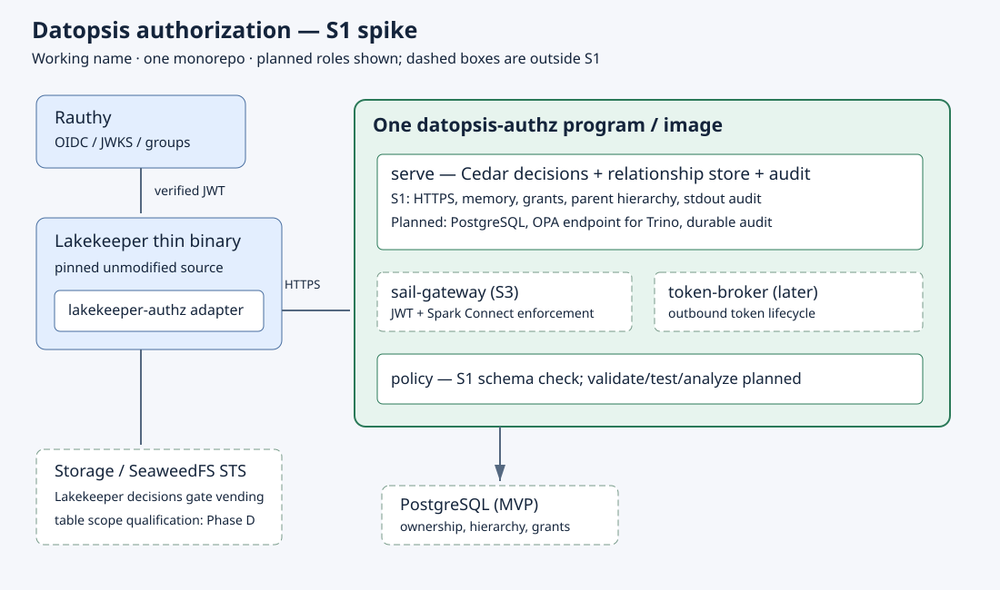

# Catalog MVP architecture (slice 1)

Owner go: 2026-11-17. One platform program with roles, Cedar library, Apache-2.0,
and a thin adapter compiled into Lakekeeper. This slice implements `serve`,
repeatable database migration and schema validation only. Epochs, Trino's OPA
endpoint, Sail gateway, token broker and hardened images are deferred.

Lakekeeper at `9bd377162345b64a716f0a4fcffe4e7e7f3c7534` verifies tokens before
calling the adapter. Decisions use its authenticated principal; JWT group claims
are discarded. Serve reads Rauthy's authoritative User API using Users/read only,
verified TLS, redirects disabled, a 2-second timeout and a 250 ms bounded cache.
No per-principal opt-in or epoch/claim fallback exists. The fixture's Rauthy image
is pinned at `01375efb2a14692a7977f2f8aa60121f3fcc2f01`. This coordinator-approved
[unmerged Rauthy PR #3](https://github.com/datopsis/rauthy-ubi/pull/3) test pin
verifies FIDO serial 302. Its SvelteKit gate remains RED pending an owner decision;
building it for acceptance does not waive that gate. Normal tokens live 900s.
Explicitly configured machine subjects can receive direct grants when the User
API returns 404, but never group grants; all other missing users fail closed.
An IdP outage denies after the cache TTL, including machine lookup failures.

The relationship database uses extension-free `datopsis/postgresql-ubi` at
`c31b5b8f53873c0e733d5271df45fba4643a4334` (PostgreSQL 18.7). Lakekeeper's catalog database retains
its separate extension-enabled image, pinned to the merged 18.7 owner commit
`1054729c5fa934e2a801a36d81a8b2b264aa8829`. The wrapper selects these immutable
inputs in memory; the external acceptance checkout is not edited. Both database
connections use verified TLS.
`migrations/0001_catalog.sql` runs transactionally under an advisory lock.
The MVP stores its serialized graph in a single PostgreSQL row; mutation and
check/audit transactions acquire its row lock, so multiple service processes
cannot lose writes or evaluate stale local snapshots. This deliberately simple
implementation serializes evaluation and is not throughput/HA qualified.
No database state is held across process restarts. Grant IDs are SHA-256 hashes
of canonical grant serialization, stable when unrelated grants are inserted.
Every evaluated check has principal, operation, resource, boolean decision,
policy IDs and a fixed reason string persisted in the same transaction before
responding. IdP/evaluation failures produce audited denial and a 503.
Grant-management decisions retain their audit even when a subsequent malformed
mutation returns 400; invalid requests never change the relationship graph.

## Permission management

The adapter adds these authenticated catalog routes:

- `GET /management/v1/permissions/{kind}/{id}/grants`
- `POST /management/v1/permissions/{kind}/{id}/grants`

Kinds: server, project, warehouse, namespace, table, view, generic-table.
POST JSON is `{"subject":{"kind":"User","id":"oidc~…"},"access":"select","remove":false}`.
Subject kind can be User or Group; access is owner or select. `remove:true`
revokes the exact grant. Both routes return the resource's direct grant list.
Inherited owner authorization is evaluated in the same transaction as changes.
The C-suite's tuple adaptation invokes these routes with the real operator token,
then verifies GET readback. The fixture translates OpenFGA's lakekeeper_table
identifier into the catalog's table route; C4 starts at the POST acknowledgement
before readback. Readers' mutation attempts must deny.
These are Cedar-native routes, not OpenFGA assignment-wire compatibility.

All nine action batch methods forward catalog checks; project discovery requests
item filtering rather than claiming global visibility. Lifecycle hooks persist
server/project/warehouse/namespace/tabular ancestry and resource owners.
Select grants cover metadata/read/discovery, never write or ListEverything.
Configured instance-admin bypass is rejected at adapter startup because it skips
the pluggable authorizer and its durable audit. In-process Lakekeeper maintenance
uses upstream internal privilege/auditing; this is not a user-grant path and its
event stream is not durably integrated with serve in this slice.
Role actions/assumption/administration, other-user inspection and delegated
execution deny. Unsupported permission paths return 403; OpenAPI composition is
not implemented. Health reporting is not yet qualified. The complete trait
inventory remains in the S1 spike report. Rename still uses Lakekeeper's
before/after hooks rather than a distributed transaction with the catalog DB;
a failed attach denies inherited access until repair, and cross-database reconciliation is
not implemented.

## Validation and dependency boundary

Fixture revisions and the unmerged Rauthy pin's security status are recorded in
`evaluation/s1/inputs.json` and retained in each native result artifact. Both the
preflight and the upstream owner build enforce the new locked FIDO bytes; the
owner's authenticated-feed verifier remains mandatory. The CI preflight makes at
most four publisher requests on HTTP 429, respects Retry-After (or a 60-second
minimum) and fails if the requested delay exceeds the bounded 120-second wait.
It retains only exact hash-matching bytes in the job's ignored input directory;
the owner build reuses those generated bytes, rechecks their hash and still
requires fresh CRLs plus authenticated-feed verification. This avoids a redundant
publisher request without weakening any input check. Native catalog assertions
must pass independently on both architectures. Fresh human tokens with empty
group claims retain the upstream RoleSourceIdError compatibility gap.

C1–C8 preserve the original assertion IDs and strict typed denial oracle, including
C3's retained old token and C8's complete state comparison and two repetitions
of both migrations. No resets occur inside restart assertions. C5 continues
checking all three clients' catalog permissions; it does not qualify engine
end-user propagation. An additional IdP outage check waits past the membership
cache TTL and requires a structured error without metadata or credentials.

`dependency-audit.py` retains full-lock findings, the actual selected normal
runtime tree (excluding procedural macros) and separate blocking/non-blocking classification. quick-xml 0.40.1
is an unconditional Azure dependency at the Lakekeeper pin, not an optional
feature that Cargo can disable. libsqlite3-sys is locked but not in the selected
runtime tree. No feature has been removed yet and no ignore list exists.
No new crate or version is required for the implementation: sqlx 0.9.0,
reqwest 0.12.28, sha2 0.10.9 and serde were already locked.

Owner decision 2026-11-18: "upstream Lakekeeper, Azure path, no fix yet; upstream proposal in progress". Lint remains RED. No ignore entry and no S3-only
Lakekeeper patch are permitted. Complete the other slice-1 work; obtain green
C1–C8 on both architectures using the coordinator-approved repaired Rauthy pin.
Merge waits for the upstream fix.
