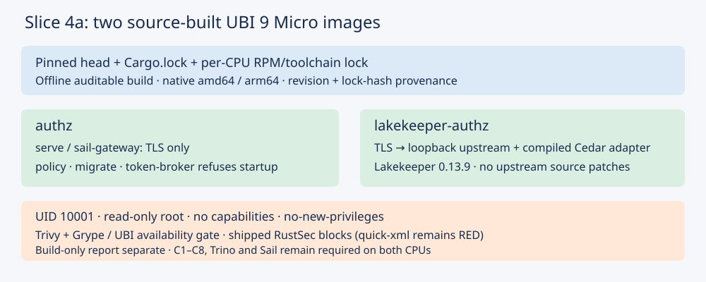

# Hardened images (slice 4a)

This PR builds two native images from the same repository head on amd64 and
arm64. They are test artifacts until all blocking security gates pass. The known
Lakekeeper Azure/quick-xml advisories remain honestly red; there are no ignores.

| Image | Binary | Commands |
| --- | --- | --- |
| authz | datopsis-authz | serve, sail-gateway, policy; migrate and private sail-socket helper |
| lakekeeper-authz | lakekeeper-datopsis | serve, migrate, version |

Each deployment selects a command; both default to serve. `token-broker` is
recognized but fails closed because that role is not implemented. It does not
mint tokens or start a listener. Policy validation starts no listener.

## Build and provenance

`Containerfile` is a multistage UBI 9 source build, with a Micro runtime. Use only
PR Actions for acquisition, image builds, scans, runtime checks and native CPU
validation. `artifacts/images.lock.json` records each architecture's builder and
Micro image digests, full build/runtime RPM closure by NEVRA and SHA-256, Rust
1.94.1 archive, protoc 30.2 and cargo-auditable 0.7.8 native tool archive checksums, and Cargo.lock's
hash. RPM snapshots are copied from datopsis/rauthy-ubi commit
4d196b87639e410a01ca5dab353826ae13ee445c; they are explicit reviewed inputs,
not a resolver run during builds. The full builder closure is conservative; only
the runtime closure reaches the final image. Installation checks bytes, exact
NEVRAs and Red Hat signatures, with network disabled. Cargo acquisition precedes
`cargo auditable build --release --locked --offline` with network disabled.
The tool archives use the official musl builds and release-asset SHA-256 values.
Version 0.7.8 emits format 2, fixing proc-macro classification when a crate also
has test/example/build targets. Embedded inventory qualification runs before
external fixture builds. Unit tests use the release profile to reuse the same
compiled dependencies in the auditable image build; every workspace test remains.
No upstream Lakekeeper source is patched.

Authz production builds select only `-p authz-serve` in a separate workspace
containing authz-core/authz-serve. Stable cargo-auditable uses `cargo metadata`,
which otherwise resolves the other workspace members and can overinclude
optional SQLx SQLite packages that the selected compilation graph never builds.
The isolated lock is pruned offline from the reviewed source lock; a mandatory
check allows only removal of package identities/dependency edges, forbidding
new versions, sources, checksums or edges. Production compilation remains
`--locked --offline`. The committed Cargo.lock and catalog build are unchanged.
An early binary inventory assertion requires both sqlx-sqlite and libsqlite3-sys
to be absent from authz; no RustSec finding is suppressed or reclassified.

Lakekeeper source matches lakekeeper-ubi: 0.13.9 at
`a8e013b30e99e5a184486fe166c3ffb3781a7c36`. Our workspace carries upstream's
SQLx cancellation fix pinned by commit, not its mutable tag. See the complete
[dependency/interface review](evals/slice-4a-lock-review.md).

CI checks both `org.opencontainers.image.revision` against the checked-out PR
head and `io.datopsis.artifact-lock.sha256` against images.lock.json. It records
image IDs, uncompressed image sizes, binary hashes, CPU architecture and actual
cargo-auditable inventories. No published registry tag or release is claimed.
The existing catalog/Trino/Sail fixtures consume these exact image IDs via their
old local aliases; they no longer layer development binaries onto an owner image.

## Runtime contract

Run as UID 10001 (group 0 permits the existing protected root-group fixture
mounts). Deploy with `--read-only --cap-drop ALL --security-opt
no-new-privileges:true`. These runtime controls must be supplied by the
orchestrator; an OCI image alone cannot impose them. Mount credentials, CAs and
TLS material read-only. Supply private bounded tmpfs only for roles that need
writable sockets. Publish only TLS ports. No default service/encryption key,
plaintext public fallback, capability or privilege escalation is supported.

Serve uses the README's AUTHZ_* configuration and defaults to TLS port 8443.
Sail gateway uses [SAIL.md](SAIL.md) and defaults to TLS port 50051. Missing
credentials/TLS files and unsupported roles fail startup. The private Sail
socket helper has no public TCP listener.

The catalog requires `AUTHZ_TLS_CERT`, `AUTHZ_TLS_KEY`,
`LAKEKEEPER__PG_ENCRYPTION_KEY` (private, at least 32 characters, never the public
upstream default), the adapter's AUTHZ_ENDPOINT/CA/key configuration and upstream
verified database/OIDC settings. `LAKEKEEPER_TLS_LISTEN` defaults to
`0.0.0.0:8181`. The image defaults `LAKEKEEPER__BIND_IP=127.0.0.1` and
`LAKEKEEPER__LISTEN_PORT=8182`; changing the bind IP to a non-loopback address
fails startup. Our TLS transport forwards to the unmodified in-process upstream
API on loopback; its metrics port is also loopback-only. Neither private port may
be published. TLS handshakes and connections are bounded. Migration is an
explicit command needing the encryption/database configuration and starts no
listener. Version requires no secrets. There is no TLS-off switch.

The integration fixture preserves its external TLS assertions and NGINX boundary,
adds verified HTTPS on NGINX's catalog-backend hop, and mounts generated config
without editing the pinned owner's repository. C3's direct-claim adaptation and
all original permission/denial oracles remain documented and blocking. C6 now
requires the absence of credential-less entries with its static non-STS profile.

## Security admission

Trivy and Grype scan both final images without ignore lists. The organization
HIGH/CRITICAL gate blocks fixes installable from the build's native UBI BaseOS,
AppStream and CodeReady Builder repositories. RPM fixes unavailable there are
reported as deferred; unfixed findings remain reported. Non-RPM fixes and query,
scanner, inventory or metadata errors block. The shared UBI gate comes from
lakekeeper-ubi commit fe19d7f9a5e603c7f7457f4a3a56e1af8cd8d2e7 (Apache-2.0).
Its availability policy and thresholds are unchanged.

The independent RustSec gate reads the shipped ELF's `.dep-v0` section, requires
cargo-auditable format 2 or newer, separates runtime from build/proc-macro
packages, and classifies every full-lock vulnerability and advisory warning.
A runtime advisory blocks iff RustSec reports a nonempty `versions.patched`
list, irrespective of severity or advisory type (owner decision 2026-11-27).
No-patch runtime advisories are reported and tracked without blocking. Packages
not selected for that binary go into a separate non-blocking report. Missing or
malformed evidence fails closed. No reachability claim or advisory exemption is
used. Stable Cargo's embedded graph can conservatively overinclude runtime
packages; it is not an instruction-level reachability analysis.

Native CI retains raw scanners, UBI availability evidence, RustSec reports,
embedded inventories and hardening/size/provenance results. The required lint
and test names remain. Security qualification requires actual current-head
results on both CPUs; unit tests or historical slice-3 passes cannot substitute.

