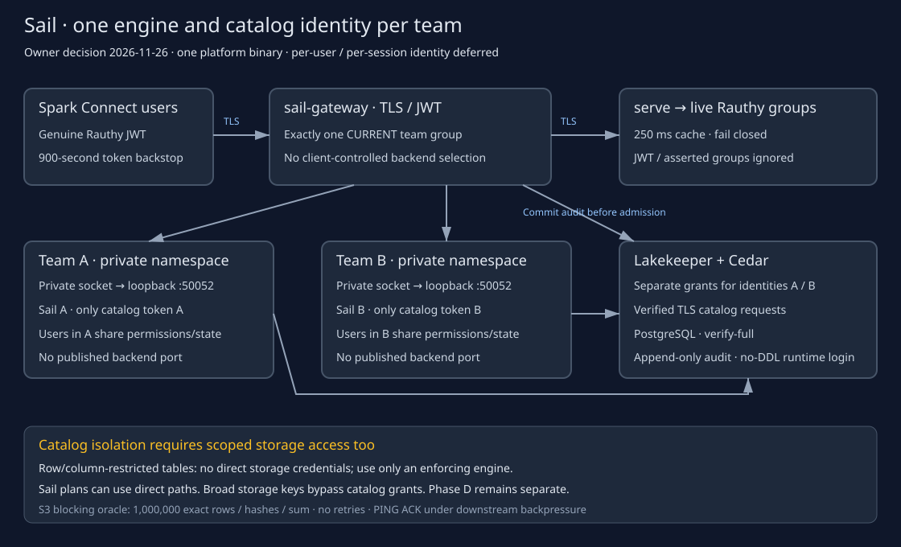

# Sail gateway: one instance per team (MVP slice 3)

Owner approved 2026-11-26. Stacked on slice 2 (#7) and slice 1 (#5).
One platform binary implements `sail-gateway`, and the internal `sail-socket`
transport helper. Sail remains unmodified at owner commit
`e96e068f926b8fecb3939e953389685ee4780032` (Sail 0.7.3).



The gateway terminates TLS/HTTP2, requires RS256 JWTs from the configured Rauthy
HTTPS JWKS, and validates signature, exact issuer, audience, subject, expiry and
nbf with zero clock leeway. Every admitted RPC is validated against a JWKS fetched
for that RPC; there is no stale-key admission. A token is first checked against
the last fetched key set (at most 60 s old): a token whose signature verifies but
whose claims are invalid is refused without an IdP round trip, and a token no
cached key verifies (unknown `kid`, bad signature) may trigger at most one JWKS
refresh per endpoint per second, otherwise it is refused. Unauthenticated
clients therefore cannot amplify requests toward Rauthy. JWT groups and client identity headers never choose a backend.
For every RPC, the private `/sail/groups` route uses **the same live Rauthy lookup
as catalog and Trino**, with the same bounded 250 ms cache, two-second timeout,
Users/read credential, verified HTTPS and fail-closed behavior. Exactly one
configured team group must match; zero or multiple matching teams deny. Team
configuration is administrator-controlled and immutable for the process lifetime.
There is no user-supplied team, backend address or catalog token.

After bounded unary request collection, membership is checked again before the
permit audit and backend connection. Removing membership denies subsequent
admission after the cache expires, even with the old unexpired token. Configure
Rauthy access tokens to 900 seconds as the backstop; token lifetime is not the
membership revocation mechanism. This does not cancel an already admitted query
or erase data or temporary state it produced. A request already authorized when
a membership update commits can finish. Native CI measures denial within five
seconds of acknowledged group removal and repeats the old-token refusal.

Every admission result, including malformed/missing JWTs, ambiguous membership,
unsupported methods and dependency failures, is appended to `authz_audit` with
principal, `sail:admit`, team resource, configured team policy ID, fixed reason,
RPC method and gRPC status. Invalid JWTs have principal `unauthenticated`;
unverified subject text and credentials are never audited. Durable rows for
invalid-token refusals are rate-limited (burst 50, 20 per second per gateway
process); suppressed refusals are still refused and counted in
`gateway_audit_suppressed` log events. A verified token that expires while its
request is uploading is refused with reason `sail_token_expired` and keeps its
verified subject. PostgreSQL uses
verify-full and the existing append-only schema. Audit commit precedes backend
access. An audit/database failure denies with gRPC UNAVAILABLE; an unavailable
audit database cannot durably record its own outage. Permitted admission is
recorded even if the subsequent Sail connection fails. Transport failures before
an HTTP/2 request exists cannot be admission records.

## Provisioning

Provision one static Sail container per team, each in a separate network
namespace. Bind Sail to `127.0.0.1:50052`, publish no backend port, and mount only
that team's protected catalog-token directory. Give each team a separate Rauthy
machine identity and only its team's Lakekeeper grants. **Never put an operator
or shared cross-team catalog token in Sail.** Register those machine principals
in serve's explicit `AUTHZ_MACHINE_PRINCIPALS` list. Add each dedicated OAuth
client audience to Lakekeeper's exact `LAKEKEEPER__OPENID_AUDIENCE` allowlist.
For example, the fixture retains `lakekeeper,operator,expiry` and adds only
`sail-team-a,sail-team-b`. Do not use an audience wildcard or admit the engine
client audiences at the gateway: `SAIL_AUDIENCE` remains the end-user client
allowlist. Mount catalog-token files
read-only, UID 10001 mode 0400, with private parent directories. Refresh each
team's machine token using a trusted supervisor and atomic replacement inside its
own mounted directory. Automatic issuance/lifecycle is the later token-broker
slice; this gateway does not hold or mint catalog tokens.

Run `datopsis-authz sail-socket` beside each Sail in its network namespace:

```
SAIL_SOCKET=/socket/sail.sock
SAIL_BACKEND=127.0.0.1:50052
```

The helper accepts only a loopback backend. Give it a unique private socket
directory, writable only by the helper UID. It creates a mode-0600 socket and
refuses existing paths. The trusted supervisor must remove its own stale socket
before restarting the helper. Mount each socket directory only into its helper
and the gateway, using the same UID. Do not mount other teams' sockets or token
directories into Sail. No Docker socket, privileged namespace relay, published
TCP relay or host agent is part of the gateway.

The gateway reads `SAIL_TEAMS_FILE` containing an array such as:

```json
[
  {"id":"team-a","group":"team-a","socket":"/teams/a/sail.sock"},
  {"id":"team-b","group":"team-b","socket":"/teams/b/sail.sock"}
]
```

Duplicate team IDs, group mappings, or backend paths fail startup. Socket paths
must be absolute. Gateway configuration:

- `AUTHZ_TLS_CERT`, `AUTHZ_TLS_KEY`, `AUTHZ_LISTEN` (default `0.0.0.0:50051`).
- `SAIL_ISSUER`, `SAIL_AUDIENCE` (comma-separated exact audiences), `SAIL_JWKS_URL`.
- `AUTHZ_ENDPOINT` (private serve HTTPS URL), `AUTHZ_CA_FILE`, `AUTHZ_KEY_FILE`:
  the gateway's **decision-only** credential, the same file serve reads as
  `AUTHZ_DECISION_KEY_FILE`. It is accepted only on `/sail/groups` and `/decide`,
  never on `/mutate`, `/snapshot` or `/permissions`. Never give the gateway
  serve's admin `AUTHZ_KEY_FILE`.
- `AUTHZ_DATABASE_URL_FILE`, `AUTHZ_DATABASE_CA_FILE` for durable admission audit:
  the least-privilege runtime login (README, "Database logins"). The gateway runs
  no DDL and refuses to start with an owner, superuser or over-privileged login.
- `SAIL_TEAMS_FILE` for the static group-to-private-socket mapping.

Private JWKS and service calls use verified HTTP/2 TLS, no redirects or ambient
proxy, five-second total timeout and a 4 MiB response limit. Serve and PostgreSQL
must be reachable from the gateway over their private TLS routes. End users must
not reach those service APIs or the socket directories. Deploy Sail/helpers with
read-only roots, dropped capabilities, no-new-privileges and private bounded
tmpfs. The native fixture uses 2 CPUs / 2 GiB per Sail with 256 MiB tmpfs mounts.
TLS certificates and all credentials are operator-provisioned protected files.

The gateway supports the bounded unary Spark methods listed in source, rejects
unknown methods, AddArtifacts streaming and compressed request frames, and limits
requests to 4 MiB / 30 seconds. It replaces all top-level UserContext occurrences
with the verified subject and strips tokens and asserted identity headers. It
does not inspect SQL/plans or implement table authorization itself.

## Isolation and storage limits

Lakekeeper sees the **team machine identity**, and enforces that identity's
catalog grants. Users within a team share permissions, sessions, cached data and
temporary state. Spark session IDs are not a security boundary within a team.
Separate instances isolate cross-team sessions, including deliberately colliding
session IDs. Per-user instances and per-session identity are later work.
Revoking a team's catalog grant does not purge engine caches or running queries.
Host/root access and the trusted gateway/supervisor remain privileged.

**Standing rule:** row/column-restricted tables must not be readable using direct
storage credentials. Sail does not enforce Trino's row predicates or column masks.
Withhold these tables and their storage credentials from Sail and direct clients;
allow reads only through an enforcing engine. Team storage credentials also need
team scope: arbitrary direct-path Sail plans bypass catalog authorization when
an engine holds broad bucket keys. Phase D scoped vending remains separate work.
CI uses private shared static storage credentials as fixture scaffolding and
checks named catalog tables; it does not qualify storage-path isolation.

## Per-team instance cost

[S5 native measurements](https://github.com/datopsis/datopsis-authz/blob/01c0bfa6502077c2b88cb15c9e5859bf89477912/docs/spikes/S5-per-user-sail.md)
(run [44815134976](https://github.com/datopsis/datopsis-authz/actions/runs/44815134976))
measure the same Sail 0.7.3 process boundary: one process cost applies per team
here, rather than per user. Idle RSS was 61.758 MiB amd64 / 62.059 MiB arm64;
sampled peak RSS during the million-row analytical sequence was 206.734 / 216.121
MiB. Prebuilt cold TCP readiness was 0.261 / 0.226 seconds, excluding image pulls.
The light SELECT-42 pool used about 95–100 MiB RSS per resident instance at 20
instances. These workloads are bounded observations, not production sizing or a
latency SLA. They exclude shared infrastructure, and RSS double-counts shared
pages. Budget separately for analytical joins/scans/spill, CPU, tmpfs, the gateway,
helpers, catalog, Rauthy, databases and storage. Memory is workload dependent.

## Blocking checks

Native amd64/arm64 CI uses the exact slice-2 Rauthy and Trino pins. It tests genuine
human tokens and all specified JWT refusals, exact own-team table listings/rows,
other-team read denial, colliding session IDs, live group removal and old-token
refusal, service/IdP outages and recovery, TLS/plaintext, private backends, team
catalog identities, protected token mounts and durable permit/deny audit.

The S3 slow-reader oracle remains blocking: the unmodified owner client requests
1,000,000 rows, paces the first 16 batches at five seconds, disables all retries
and reattachments, and checks every unique ID, SHA-512 payload and exact sum
499,999,500,000. Passive capture proves the result connection ACKs Sail's PING
while downstream DATA is backpressured, with zero drops/reassembly gaps. Separate
connection drivers poll HTTP/2 control frames while stream DATA waits for capacity;
upstream DATA credit is released only after downstream acceptance. The private
socket bridge relays bytes without changing Sail's keepalive settings.
C1–C8 and every slice-2 assertion remain separate blocking regression checks.
Missing prerequisites remain BLOCKED, and inherited security gates stay red.
See the [S3 follow-on report](spikes/S3-sail-gateway.md) and PR evaluation record for actual evidence; spike passes do not qualify
this implementation. Local checks are limited to lightweight source/unit checks.
