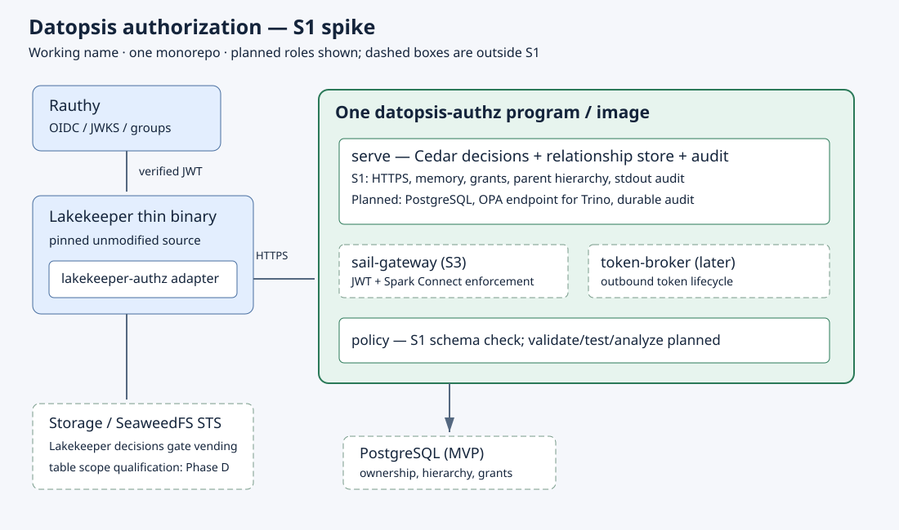

# Trino enforcement (MVP slice 2)

Owner approved 2026-11-25. Slice 2 is stacked on catalog slice 1, PR #5.
The `serve` role exposes the Trino 484 stock OPA protocol; OPA itself is not
required. Both adapters evaluate the same Cedar grants, resource UUIDs and live
Rauthy membership against the same locked PostgreSQL graph. No JWT group claim
or Trino group assertion grants access. The membership cache is bounded to 250 ms;
IdP, database, evaluation and audit failures fail closed. Trino decision caching
must remain disabled. Revocation affects subsequent requests, not running queries
or already fetched data.



Configure a private, verified HTTPS route from Trino to serve. Provision a separate
protected `AUTHZ_TRINO_KEY_FILE` (at least 32 characters, different from
`AUTHZ_KEY_FILE`). Without it the OPA routes reject all requests. Trino forwards
that key using `opa.context-file`, containing `serviceKey=<decision-only key>`.
This credential cannot access native decision, snapshot or mutation routes.
Never enable `opa.log-requests`: it exposes the context credential. End users
must authenticate to Trino; only the trusted engine may assert their Rauthy
principal (`oidc~<subject>`). The CI fixture uses TLS password authentication for
this hop and Rauthy-issued OAuth credentials for the Iceberg REST connector.
Do not expose either decision API directly to clients.

```
access-control.name=opa
opa.policy.uri=https://serve:8443/opa/allow
opa.policy.batched-uri=https://serve:8443/opa/batch
opa.policy.row-filters-uri=https://serve:8443/opa/rows
opa.policy.column-masking-uri=https://serve:8443/opa/mask
opa.policy.batch-column-masking-uri=https://serve:8443/opa/batch_masks
opa.context-file=/etc/trino/context.properties
opa.http-client.request-timeout=5s
```

Configure the OPA HTTP client's trust store with the private CA. Plain HTTP,
permissive trust and fail-open fallbacks are not supported deployment choices.
The scalar paths also work when both batched URI properties are omitted.

| Endpoint | Result inside the OPA `result` envelope |
| --- | --- |
| `allow` | Boolean permission |
| `batch` | Zero-based allowed resource indexes; FilterColumns indexes the sole table's columns |
| `rows` | Array of SQL view expressions |
| `mask` | A SQL view expression or null |
| `batch_masks` | Array of `{index, viewExpression}` entries; absent indexes remain unmasked |

SELECT, SHOW and list filtering require `read_data` on the bound table UUID.
Catalog/schema visibility requires at least one visible bound table. Query
execution requires a readable binding. Unknown operations, writes, unbound names
and unrelated connectors deny. Iceberg information_schema reads rely on Trino
484's subsequent item filtering; native CI checks exact metadata rows as well as
SHOW output. Table-read parity means matching table authorization, not matching
row/mask behavior in the catalog API.

SQL names are explicit administrative bindings, stored durably alongside grants.
The protected native `/mutate` API accepts:

```json
{"op":"bind_trino","name":["iceberg","sales","orders"],"binding":{"resource":{"kind":"Table","id":"<catalog table UUID>"},"region_column":"region","sensitive_column":"email"}}
```

The table must already exist in the relationship graph. Bindings must be
provisioned from trusted catalog metadata, never from user assertions. Dropping
or detaching a table removes its bindings. A rename's detach hook therefore
invalidates the old name; an administrator must bind the new name after the
catalog operation completes. Missing bindings deny until provisioning finishes.
Automatic name discovery and rename reconciliation are not implemented.

Row rules are deliberately bounded templates, not arbitrary SQL policies.
`region_column` compares a quoted SQL identifier with a quoted literal from the
principal's durable region attribute (`{"op":"set_region","principal":"oidc~…","region":"eu"}`).
Missing region attributes fail closed. A `sensitive_column` is masked with SQL
NULL, which Trino coerces to its type. Quotes in identifiers/literals are escaped.
Cedar `unrestricted_rows` and `unmask` grants exempt their subjects from the
respective restriction but do not grant table reads. An owner has both exceptions.
These grants use the same subject/resource/inheritance model and policy IDs as
select grants; they can be managed using the owner-authorized grant API.

For an unreadable or unknown table, obligations return FALSE rows / NULL masks
before the final scalar SELECT denial. Trino requests obligations before its final
SELECT check; a normal denial must not be misreported as an OPA transport error.

Every authenticated, well-formed OPA request records its principal, operation,
SQL target names, policy IDs and exact result (including each batch index and
row/mask expression). Every Cedar subdecision is also appended to the durable
audit. No context credential or group list is recorded. The graph lock spans
all evaluation and audit inserts; commit precedes the response. The repeatable
`0002_trino.sql` migration adds the nullable result field without changing
existing audit rows. Malformed/unauthenticated HTTP requests are transport
rejections, not authenticated policy decisions.

**Standing storage rule:** a table with any row or column rule must not be
readable through direct storage credentials. Only an enforcing engine may hold
its storage credentials; catalog clients, PyIceberg and non-enforcing Sail must
not receive them. Lakekeeper's table-level authorization does not apply SQL
obligations to Parquet files. Deployment must isolate the connector credential
and storage network and prevent direct credential vending for these tables.
Slice 2 does not implement Phase D's scoped STS broker or a credential-vending
policy. Do not enable these rules in a deployment that cannot meet this rule.
CI's static storage keys are private fixture scaffolding, not a production pattern.

CI retains C1–C8, job names `lint` and `test`, and native amd64/arm64 execution.
S2 assertions cover exact SELECT/SHOW/metadata rows, row restrictions, NULL masks
and owner exceptions, table parity, shared grant and live-group revocation within
five seconds, engine outage, restart durability, credential separation and durable
audits. Runtime evidence belongs in the PR and sanitized Actions artifacts. The
[current evaluation record](evals/2026-11-25-trino.md) records blocked cases explicitly.
No local image builds, artifact acquisition, scans or runtime tests are permitted.

CI builds the coordinator-approved unmerged [trino-ubi PR #8](https://github.com/datopsis/trino-ubi/pull/8)
commit `9343071e44fc58e4848c6e6b66ae1403a394d17f` directly through the pinned owner
fixture builder. It contains Iceberg and OPA 484; OPA remains opt-in through the
configuration above. No derived plugin layer or separate plugin acquisition is
used. The same immutable revision is recorded in fixture inputs and S2 results;
the owner builder retains native architecture, source and artifact-lock checks.
This is an approved test pin, not release-image qualification: the unmerged
combined image remains red on known Iceberg JAR CVEs. The referenced PR can move;
CI uses only the approved full commit. Rauthy remains blocked pending the
coordinator's replacement pin for the verified in-repository serial-303 FIDO copy.
Do not work around the existing Rauthy checksum or authenticated-feed guards.
No new Cargo crate or version is needed. The inherited quick-xml lint failure
remains unsuppressed.
