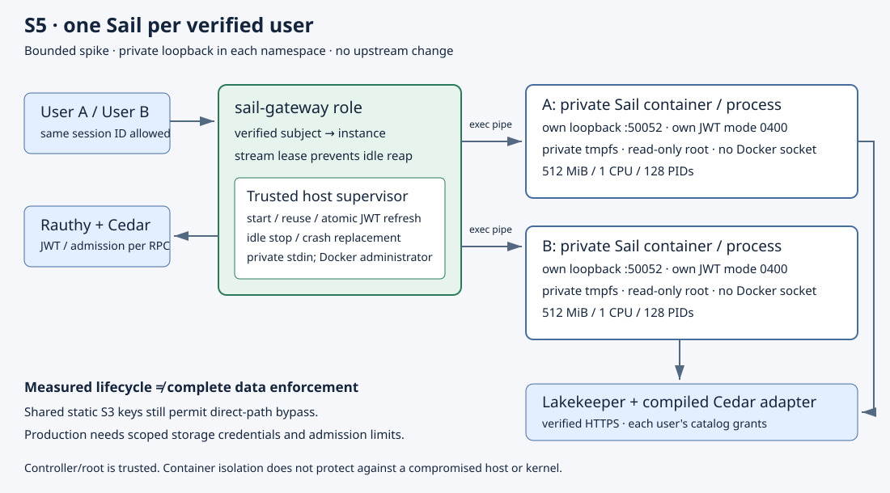

# S5: per-user Sail lifecycle and isolation

Status: **PARTIAL. Native engine costs and resource caps measured; authenticated
per-user lifecycle/isolation BLOCKED by a pinned Rauthy acquisition failure.**
Do not interpret the engine measurements as a passing S5 or an MVP go decision.

[Stacked PR #6](https://github.com/datopsis/datopsis-authz/pull/6) targets
`room/datopsis-authz-spike-s3-sail-gateway`. No merge. The owner's per-team MVP
choice remains unchanged.

## Verdict and blocking prerequisite

Sail process economics support further evaluation of a hybrid: per-team by
default, with per-user instances for sensitive groups after the blocked controls
pass. Twenty warmed engines used 2.820 GiB/2.707 GiB of charged container memory
on amd64/arm64 for the tested aggregate workload. This is promising bounded engine
cost evidence, **not proof of authenticated per-user data enforcement**.

Both native jobs reject Rauthy's mutable FIDO MDS download at the owner's original
SHA-256 assertion before starting Rauthy, Lakekeeper or the gateway. The lock
expects blob 301, SHA-256
`bcdf74e5c25d529de6007f1e49b53bed01d38ce57452e2585f71c7fd95ff0b09`.
An independent cloud download returned blob 302 with SHA-256
`d2ad4e42a8afbd74a34b3e997ae46d43df9e046f8a5bf1feda97206d8c84e0bb`.
This separate probe is not a retained native download digest or a JWT-signature
verification. [Acquisition evidence](S5-rauthy-acquisition.json) records the native
errors, expected lock, probe and timestamps. The latest published Rauthy owner
commit checked, `4d196b87639e410a01ca5dab353826ae13ee445c`, has the identical FIDO
pin, so moving to it would not fix acquisition.

The owner's [acquisition contract](https://github.com/datopsis/rauthy-ubi/blob/1e114b84b01988bf15306b110b040378878488d3/docs/ARTIFACT-ACQUISITION.md)
requires retaining the verified bundle after the public feed rotates. Published
owner artifacts did not contain that bundle. No checksum, signature check, lock,
assertion or owner source was changed. Completing S5 requires the preserved blob
301 bytes matching that hash, or a newer Rauthy owner commit refreshing/preserving
the input. No other repository was modified.

## Authoritative native evidence

[Run 44243517929](https://github.com/datopsis/datopsis-authz/actions/runs/44243517929)
tested PR source `ba6fb502e795d482754540a946ce5efc70d758b1` through merge
`9eb47439ff578b166b8bdd212c143c631c20e968`. Both native jobs' complete actual logs
and sanitized artifacts were downloaded and inspected:

- [amd64 job](https://github.com/datopsis/datopsis-authz/actions/runs/44243517929/job/134596809437)
  and [durable evidence](S5-results-amd64.json).
- [arm64 job](https://github.com/datopsis/datopsis-authz/actions/runs/44243517929/job/134596809448)
  and [durable evidence](S5-results-arm64.json).

Both hosts had four logical CPUs and kernel `7.0.0-1017-azure`; physical memory
reported to the runners was 16,760,344,576 B / 16,715,927,552 B respectively. Jobs
assert native x86_64/aarch64, and image architectures and full owner revisions;
there is no QEMU. Raw timer values, byte counts, all start/query samples, image
IDs/labels, cleanup results and log digests are retained in the JSON. Displayed
unit conversions/timers below are rounded.

The independent `engine_only.py` step runs only when owner acquisition fails.
It uses Sail's real hash-locked client and image, the same trusted supervisor,
private containers, loopback sockets and caps, with **no configured catalog and
synthetic token-file contents**. Its results never turn a blocked JWT, Cedar,
gateway or Lakekeeper assertion into PASS. Required CI remains red.

## Single instance: measured

| Metric | amd64 | arm64 |
| --- | --- | --- |
| Prebuilt process cold start to TCP ready | 0.673975 s | 0.999213 s |
| Idle Sail PID RSS before any query | 70,979,584 B (67.691 MiB) | 67,149,824 B (64.039 MiB) |
| Idle cgroup memory.current | 31,825,920 B (30.352 MiB) | 33,603,584 B (32.047 MiB) |
| Peak sampled Sail RSS during workload sequence | 235,794,432 B (224.871 MiB) | 223,989,760 B (213.613 MiB) |
| Kernel cgroup memory.peak after workload | 161,968,128 B (154.465 MiB) | 160,657,408 B (153.215 MiB) |
| Million-row SUM + COUNT(DISTINCT) ExecutePlan | 0.243237 s | 0.174611 s |
| Forced stop + container/token-directory removal | 0.137167 s | 0.157061 s |
| Direct first SELECT 42 ExecutePlan | 244.046 ms | 159.539 ms |
| Direct later SELECT 42 median (five fresh sessions) | 196.625 ms | 130.314 ms |
| Authenticated gateway first/later extra latency | **BLOCKED — not measured** | **BLOCKED — not measured** |

Start is prebuilt-image process cold start, including supervisor invocation,
container creation and the first successful TCP readiness probe. It excludes
image acquisition/build time and does not flush OS/image caches. Readiness is
TCP readiness, not completion of a catalog query.

The workload sequence is first SELECT 42, five later SELECT 42 queries, then
`SELECT sum(id) AS total, count(DISTINCT id) AS distinct_ids FROM range(1000000)`.
Both CPUs returned exactly 499999500000 and 1000000. RSS polling targets every
50 ms (inspection time adds to that interval); the kernel peak counter captures
between-poll allocations. Peak counters cover the full sequence. This is a
finite analytical computation, not an Iceberg/S3 scan, spill or large join.

Direct query timings include a fresh gRPC channel/session and a trusted
`docker exec` namespace pipe, without gateway TLS/JWT/JWKS/Cedar work. They are
**not measurements of gateway overhead**. Forced removal is SIGKILL-style
teardown; graceful drain/shutdown time is unverified.

## Concurrent engine scale: measured; authenticated-user scale blocked

Each N starts N distinct isolated containers concurrently and records every
cold-to-ready duration. After readiness, N client threads issue the same
million-row aggregate concurrently, each against its own engine. Every query
must return the exact two scalar answers. RSS and cgroup memory are then sampled
from the warmed instances before teardown. This is N engine processes, not an
assertion about N authenticated users.

| CPU / N engines | Ready-only RSS MiB | Warmed RSS MiB | Warmed cgroup MiB | Start min / p50 / max (s) | Aggregate query min / p50 / max (s) | Start / query failures |
| --- | ---: | ---: | ---: | --- | --- | --- |
| amd64 / 1 | 69.641 | 227.109 | 150.863 | 0.273123 / 0.273123 / 0.273123 | 0.266964 / 0.266964 / 0.266964 | 0 / 0 |
| amd64 / 5 | 312.152 | 1,110.441 | 731.660 | 0.560933 / 0.620878 / 0.634215 | 0.447797 / 0.513924 / 0.557677 | 0 / 0 |
| amd64 / 20 | 1,268.367 | 4,384.746 | 2,887.625 | 1.138222 / 2.112858 / 2.532942 | 0.966014 / 2.034590 / 2.291481 | 0 / 0 |
| arm64 / 1 | 62.047 | 199.141 | 135.043 | 0.198362 / 0.198362 / 0.198362 | 0.198770 / 0.198770 / 0.198770 | 0 / 0 |
| arm64 / 5 | 296.215 | 1,037.051 | 720.789 | 0.354764 / 0.384018 / 0.407409 | 0.256888 / 0.307620 / 0.378446 | 0 / 0 |
| arm64 / 20 | 1,188.902 | 4,039.977 | 2,771.750 | 0.822714 / 1.403037 / 1.497107 | 0.384643 / 1.360225 / 1.457582 | 0 / 0 |

Start samples include supervisor invocation; query samples start after all
engines and benchmark-only loopback tunnels are ready. These are separate phases,
not an end-to-end authenticated first-query measurement. The tunnels are test
transport on the trusted runner and are stopped after each batch. The proposed
Sail deployment itself publishes no backend ports.

RSS sums count shared mapped pages more than once; cgroup totals include charged
anonymous memory, tmpfs/cache and in-container relay processes. Neither is total
host RAM. Shared platform services, Docker/containerd/shims, host-side controller
helpers and startup-burst peak overhead are excluded. Cgroup charges and shared
page ownership depend on cache/teardown history. No PSS or fleet-wide synchronized
peak is claimed. The JSON also records the sum of individual cgroup peaks; those
peaks need not occur simultaneously.

## Caps, limit behavior and cleanup: measured independently

Every measured container has 536,870,912 B (512 MiB) memory, the same total
memory+swap limit (no additional swap), one CPU and 128 PIDs. Roots are read-only,
capabilities dropped, no-new-privileges enabled, with private 128 MiB tmpfs mounts
for `/tmp` and `/var/lib/sail`.

A 805,306,368 B (768 MiB) allocation by an extra process inside the Sail container
returned **137** on both CPUs; `memory.events.oom_kill` increased from **0 to 1**.
Docker recorded `OOMKilled=true` while `Running=true`: the allocation process was
killed and the container remained running. A successful post-OOM Sail query was
not checked, so application recovery is unverified. Four busy processes under
the one-CPU quota increased `nr_throttled` **1 → 32 on amd64**, **0 → 31 on arm64**.

Final independent cleanup found **zero supervised containers** and removed the
entire synthetic-token runtime directory on both CPUs. This establishes fixture
cleanup, not crash/restart reconciliation of a production gateway or actual
end-user JWT lifecycle cleanup.

## Implemented authenticated design: not runtime-qualified

Upstream [PR #2929](https://github.com/lakehq/sail/pull/2929) declined dynamic
session catalog configuration and recommended a separate lightweight server for
each client needing different catalogs. S3 additionally found that the pinned
Sail session manager looks up an existing session by session ID without checking
user ownership.

The existing `sail-gateway` role now optionally selects a distinct instance by
verified JWT subject **after** signature/issuer/audience validation and Cedar
admission. Client UserContext and session IDs never select a destination in the
implementation. S3's shared-backend mode remains when `SAIL_LIFECYCLE_HELPER` is
unset. No new Rust crates, features or lockfile entries were added.

The host gateway invokes a trusted absolute-path supervisor with private stdin
JSON. JWTs never enter helper argv or container environment. A per-user mutex
coalesces startup; a stream lease prevents idle reaping while forwarding. The
full fixture uses a 15-second idle timeout and one-second sweep. Neither its
reaping behavior nor same-user startup coalescing has native runtime evidence yet.

Sail listens on 127.0.0.1:50052 inside its own container network namespace. The
host gateway enters via an unbuffered `docker exec` HTTP/2 pipe; no Sail ports are
published. This simple per-RPC process transport adds overhead which still needs
the blocked gateway latency measurement. The controller is a privileged Docker
administrator; Sail receives no Docker socket, capabilities, host networking or
host PID namespace. Production needs a narrowly scoped controller trust boundary.

Only the instance's own read-only token directory/configuration and public CA
are mounted. Host parent directories are root-owned 0700, token directories UID
10001 mode 0500, and token files UID 10001 mode 0400. Atomic directory-mounted file
replacement refreshes the same verified subject's JWT without exposing partial
contents. The [pinned upstream catalog client](https://github.com/lakehq/sail/blob/ac4690078021cf2a5402dc5c7b38a886f1916c73/crates/sail-catalog-iceberg/src/provider.rs)
resolves credentials per REST request; real-user refresh remains untested here.
The host controller/root can read credentials by design. Container separation is
not protection from a compromised host/kernel.

A crashed instance is removed with its token directory before a new random
instance is created. The full harness intentionally reuses one session ID for
Alice and Bob, forges UserContext, verifies distinct namespace rows, cross-user
and write denials, new-table inheritance, then single-table/sibling isolation.
It also checks missing/denied credentials create no engine, concurrent same-user
startup, private mounts/tmpfs, peer TCP refusal, temp-view separation after a
crash, idle cleanup and the unchanged paced million-row stream beyond idle TTL.
These assertions are implemented but **BLOCKED, not passed**.

## Memory cost model and recommendation

At 20 warmed engines, charged memory averaged **144.381 MiB/engine on amd64** and
**138.588 MiB/engine on arm64**. Summed PID RSS averaged **219.237/201.999 MiB**.
The largest individual cgroup peak across the measured fleets was
**160.664/157.570 MiB**. A fresh TCP-ready engine's small footprint is therefore
not the appropriate active-user budget: residency grows after execution.

For this workload and cache state, a first approximation is
`RAM ≈ fixed shared overhead + live warmed users × 145 MiB + query/burst headroom`.
This is a workload-specific estimate, not a production sizing guarantee. The
512 MiB per-instance cap gives a conservative reservation of
`fixed overhead + live users × 512 MiB + runtime/controller overhead`:
**20 instance caps alone total 10 GiB**. A cap is an enforcement limit, not an OS
reservation or proof every query fits. Aggregate admission/pressure control is
still required; independent caps cannot prevent host exhaustion.

If RAM costs P per GiB-hour, the linear component is
`P × live_users × per_user_MiB / 1024` per hour, plus fixed services/headroom.
Live means a resident engine retained through the idle window, not a registered
user or an active RPC count. The 15-second fixture TTL is not a recommended
production timeout. CPU sharing, cache duplication, cold-start bursts, realistic
storage queries and post-OOM behavior need separate capacity qualification.

**Recommendation: retain per-team for the MVP; pursue hybrid after unblocking
S5.** Per-user engines look affordable for a bounded sensitive-user pool on memory
alone, but do not enable them as a qualified enforcement boundary yet. First
complete the genuine Rauthy/gateway/Lakekeeper controls and scope storage access.
The inherited STS-disabled fixture supplies shared static S3 credentials; an
admitted direct-path plan can bypass catalog grants. Process separation closes
neither that storage bypass nor all plan-level authorization gaps by itself.

## Unverified controls, failures and validation

| Requested control | amd64 | arm64 |
| --- | --- | --- |
| Single Sail start/RSS/query/forced stop | Measured | Measured |
| N=1/5/20 engines with concurrent aggregate queries | Measured; 0/0 failures | Measured; 0/0 failures |
| Memory/CPU cap enforcement and final synthetic-file cleanup | Measured | Measured |
| Authenticated start/reuse, first/later gateway extra latency | BLOCKED | BLOCKED |
| Actual N=1/5/20 authenticated users | BLOCKED | BLOCKED |
| Per-user Lakekeeper C1/C2, forged/same-session-ID routing | BLOCKED | BLOCKED |
| Full-profile peer isolation, actual JWT permissions/refresh | BLOCKED | BLOCKED |
| Idle reap, crash/reuse, foreign temp view, active stream lease | BLOCKED | BLOCKED |
| Graceful stop, post-OOM query recovery, host/controller restart/HA | Unverified | Unverified |

Failure modes: idle expiry/crash destroys session state and temp views; retries
need explicit reconnect semantics. A controller crash mid-helper can orphan
containers/credentials until reconciliation. Distributed ownership, restart
scavenging, cancellation races and aggregate startup admission are absent.
Token refresh requires new authenticated RPCs; already admitted streams and
cached metadata/storage handles have distinct revocation semantics. Shared
storage credentials, full plan/path authorization, HA and sustained/heavy-query
capacity remain gaps.

The complete workspace tests and both binaries passed native compilation/tests
on both CPUs. Local changed-package tests/Clippy, formatting, Python compilation,
YAML/SVG parsing, LF and diff checks pass. The dependency guard confirms all 690
locked package identities are unchanged; Cargo.lock has zero diff from S3.
S1/S3 assertions were retained, but their runtime re-execution in this run was
blocked before fixture startup. Historical S1 C3/C7/C8 failures remain unresolved.
The [actual audit log](https://github.com/datopsis/datopsis-authz/actions/runs/44243517929/job/134596809095)
retains three vulnerabilities (libsqlite3-sys / RUSTSEC-2026-0459; quick-xml /
RUSTSEC-2026-0194 and RUSTSEC-2026-0195), plus six warnings. No suppression,
continue-on-error audit bypass or GitHub settings/permissions/secrets change.

Earlier run 44240967339 established the same native acquisition blocker; run
44242223299 measured independent ready-only fleet memory. The authoritative run
above adds concurrent aggregate queries to measure warmed fleets. Earlier
build-only runs were superseded/cancelled, not accepted as runtime passes. The
final evidence/documentation follow-up changes no tested runtime code.
